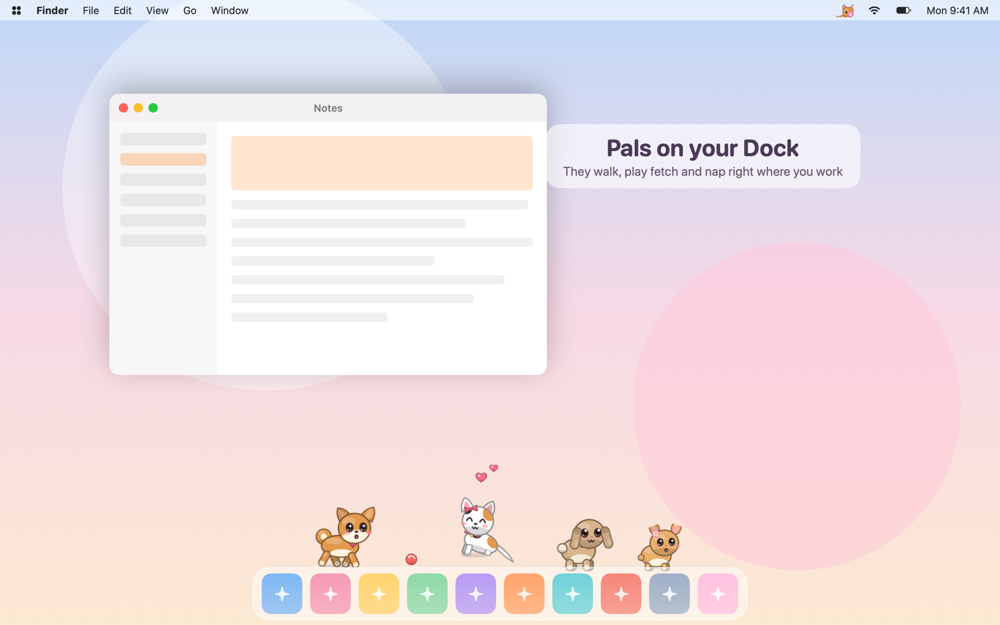
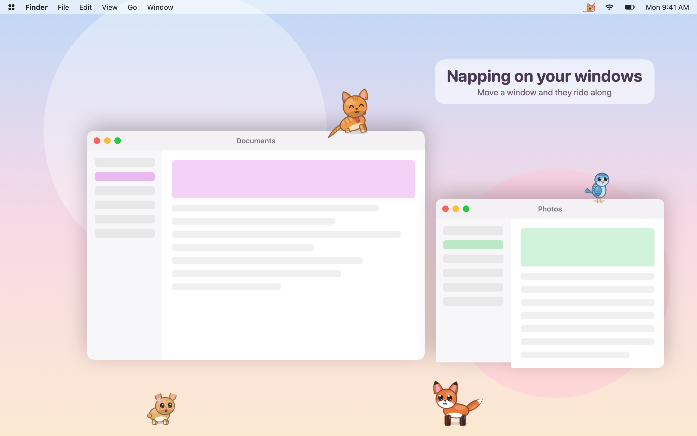
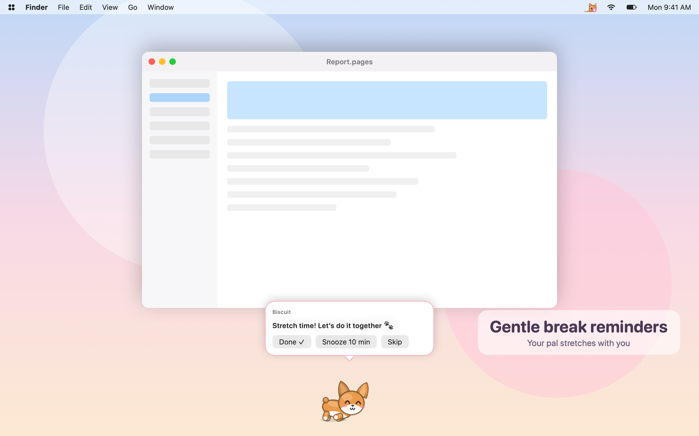
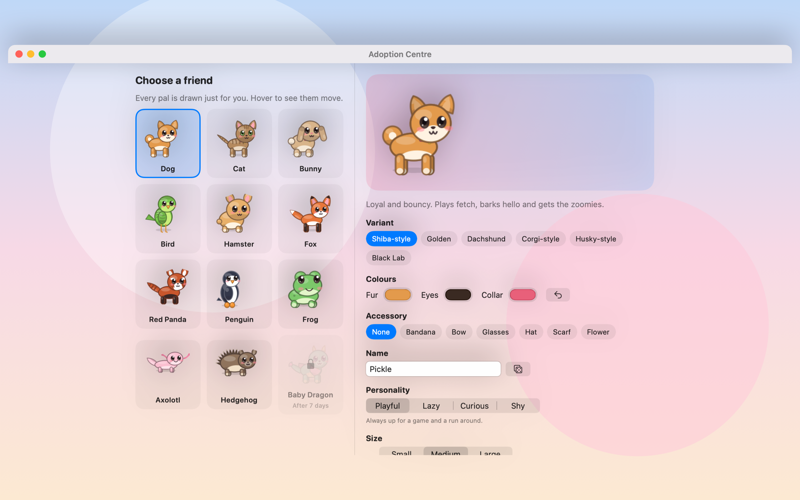

# Pocket Pals

**Cute little animals that live on your screen.**
They walk along your Dock, nap on your windows, wake up when you come back and remind you to take breaks. Every pal is drawn in code, just for you.

  

## Screenshots
| Napping on your windows | Gentle break reminders |
| --- | --- |
|  |  |

## Features
- **12 original animals**: dogs, cats, bunnies, birds (even an owl that's livelier at night), hamsters, foxes, a red panda, a penguin, a frog, an axolotl, a hedgehog and a secret Baby Dragon that hatches after 7 days together. Pick the variant, fur, eye and collar colours, an accessory, a name, a personality and a size.
- **They live on your screen.** Pals walk along the top of your Dock, hop onto windows, ride along when you move a window (and tumble off if you're too quick), peek out when a window covers them, and birds perch on a little swing under the menu bar.
- **Clicks go straight through.** Click anywhere except on a pet and it reaches your apps as normal.
- **Play with them.** Wiggle the pointer slowly to pet them, click to say hi, double-click for a trick, drag to pick them up. Double-click the Dock (or press Control-Option-B) to throw a ball for fetch.
- **Little personalities.** Zoomies, kneading, yarn-pushing, binkies, singing, hamster wheels, fox pounces, penguin belly-slides, frogs catching your "fly" pointer and more. Pals play, nuzzle and nap together in a pile.
- **They nap when you're away** and greet you with a heart when you're back. Nightcaps after 10pm, seasonal outfits, dancing when Music or Spotify plays, and a party on your birthday.
- **Break reminders**: stretch, water, eye breaks (20-20-20), posture and a wrap-up time. Your pal walks over and stretches with you. Reminders wait for calls, screen sharing, fullscreen apps and Focus, with streaks and a weekly summary. Optional Pomodoro mode.
- **Gentle care.** Feed favourite foods, play and pet to grow your friendship and unlock tricks. Pets never get sick, run away or make you feel guilty.
- **Photo Booth**: save a cute portrait with frames and stickers to your Pictures folder.
- **Light on your Mac**: about 2-3% CPU with three pets, slower when they sleep, and paused while your screen is locked. Hide them any time with Control-Option-P.
- Lives in the menu bar. Light and dark mode, VoiceOver labels, keyboard shortcuts, and Reduce Motion is respected.

## Requirements
- A Mac with Apple Silicon (M1 or later)
- macOS 14 Sonoma or later

## Install
1. [Download PocketPals.dmg](https://github.com/MilkshakeSR/PocketPals/releases/latest/download/PocketPals.dmg) and open it.
2. Drag **PocketPals** into **Applications**.
3. The first time, **right-click PocketPals and choose Open**, then click **Open** again. Pocket Pals isn't notarized by Apple, so macOS asks once.

## Updates
Pocket Pals checks for updates once a day and tells you when a new version is ready (you can also choose **Check for Updates…** from the menu bar). Change this in **Settings › Updates**.

## Privacy
- Pocket Pals looks at **window positions and sizes** only so pets can stand on them. It never reads window contents or titles, takes no screenshots and needs no Screen Recording permission.
- It checks how long since you last typed, whether a camera or microphone is in use and your battery level, so pets and reminders can be considerate. Nothing is recorded.
- Music dancing (optional) asks Music or Spotify only whether something is playing.
- Your pets stay on your Mac. The only thing that goes online is the daily update check to GitHub. No analytics, no tracking, no accounts.

## Help
- [Report a problem](https://github.com/MilkshakeSR/PocketPals/issues/new)
- [Version history](https://github.com/MilkshakeSR/PocketPals/releases)
