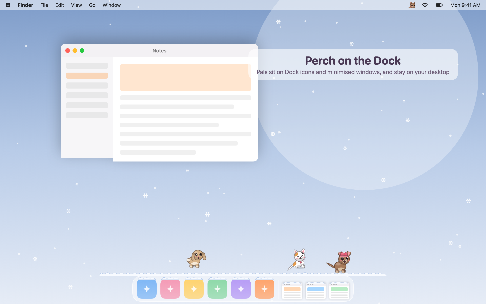
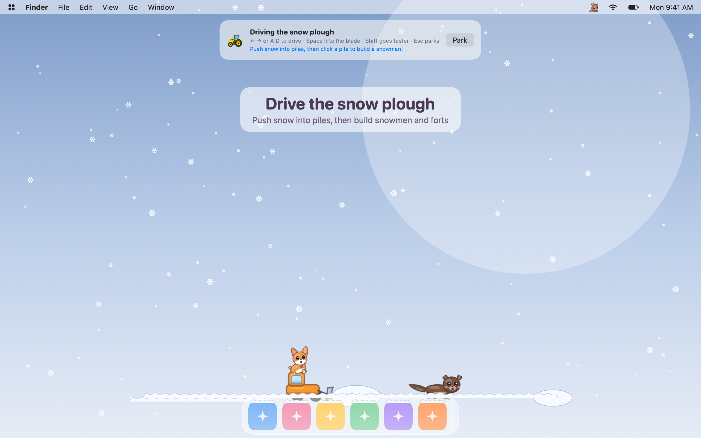
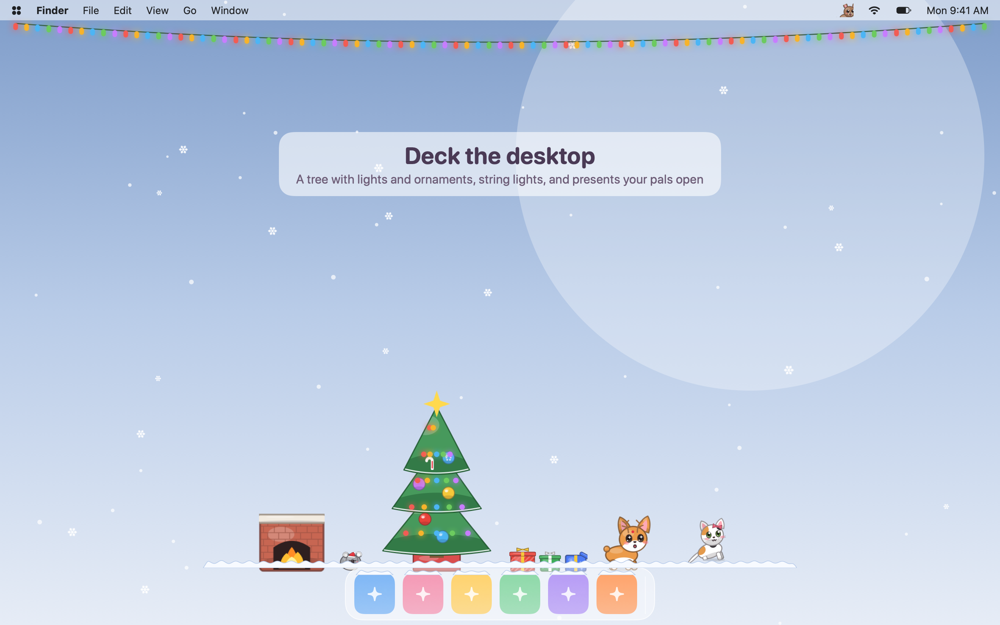
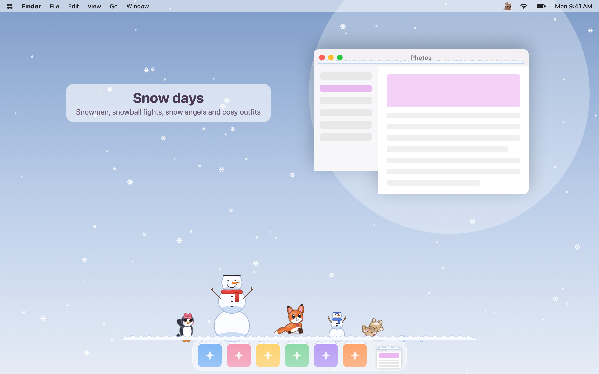

# Pocket Pals

**Cute little animals that live on your screen.**
Almost fifty original pals walk along your Dock, perch on your minimised windows, climb your windows, play with toys and games, play in the snow, grow up with you, and remind you to take breaks. Every one is drawn in code, just for you.

  

## Screenshots
| Drive the snow plough | Deck the desktop | Snow days |
| --- | --- | --- |
|  |  |  |

## Features
- **New in 1.2: Winter Wonderland.** Snow that falls behind your windows and settles on the Dock, your Dock icons and your things, a **snow plough you can drive** to push snow into piles and build snowmen and forts, a Christmas tree with twinkling lights, fairy lights, presents your pals open, an advent calendar, snowball fights, and pals in scarves and earmuffs making snow angels. Turn it on with ❄️ in the menu bar, or let it snow automatically in your winter (June to August in the Southern Hemisphere, December to February in the Northern).
- **Perch on the Dock.** Pals sit on Dock icons and minimised windows. Drag one over a Dock item and let go to perch it there.
- **Pals stay on your desktop.** They never appear inside fullscreen apps. Choose all desktops or just one.
- **49 original animals in five collections.** Classic pals (dogs, cats, bunnies, birds and more), **Aussie Mates** (quokka, wombat, koala, kangaroo and joey, platypus, echidna, sugar glider, kookaburra, cockatoo, blue-tongue lizard), **Cute & Cosy** (otter, sloth, capybara, red panda, raccoon, squirrel, guinea pig, chinchilla, ferret, mouse, lamb, piglet, pony, fawn, seal pup, polar bear cub, panda) and **Tiny Friends** (snail, bee, butterfly, ladybug, octopus, jellyfish, gecko). Each has its own colours, sound and special moves.
- **Special pals to unlock**: a Unicorn, a Phoenix, a Little Robot, a Ghost Cat who visits every October, and a Baby Dragon who learns to breathe sparkles.
- **Pet Home**: one friendly window for your pals, adopting (with a "find your perfect pal" quiz), the wardrobe, toys, games, reminders and settings. Hold Control-Option-P to open it.
- **They live on your screen.** Pals walk along your Dock, hop onto windows, ride along when you move a window, peek out from behind windows and perch under the menu bar. Hover over the Dock icons and they follow the pointer.
- **Toys and a cosy home.** Beds, bowls, balls, yarn, wheels, perches, flowers, a paddling pool, plants and a lamp that glows at night. Pals use them by themselves. Unlock them with treats you earn by taking breaks and playing (treats can never be bought).
- **Seven mini-games**: Fetch, Hide & Seek, Treat Catch, Copy Me, Bubble Pop, Pet Race and Snowball Fight.
- **They grow up with you.** New pals start as babies and grow up over ten days, learn tricks with practice, make friends with each other, and fill a daily diary with cute moments you can share.
- **Right-click a pal** for a round menu: Feed, Play, Pet, Trick, Sleep, Wardrobe, Hide and Pet Home. It always opens above the Dock, and works with the arrow keys.
- **Never in the way.** Clicks go straight through. Pals move aside if they're in your way, never sit on window buttons, hide during screen sharing, presentations, video calls and fullscreen apps, and **Shy mode** sends them to the corner.
- **Better breaks.** Friendly reminders to stretch, rest your eyes, drink water and wrap up. Your pal leads short guided stretches, a 20-20-20 eye break or a breathing exercise, and **Study with me** keeps you company through a focus session.
- **Little extras (all optional):** weather outfits, good-luck wishes before exams, dancing to Music or Spotify, celebrations on your birthday and special days for your region.
- **Shortcuts and Spotlight**: feed your pets, call a pal, start a break, hide them all, Study with me and Shy mode.
- **Light on your Mac.** Fewer frames while pals idle and almost none while they sleep, and nothing at all while your screen is locked.
- Lives in the menu bar. Light and dark mode, VoiceOver descriptions for every pal, keyboard navigation, Reduce Motion and Increase Contrast are respected.

## Requirements
- A Mac with Apple Silicon (M1 or later)
- macOS 14 Sonoma or later

## Install
1. [Download PocketPals.dmg](https://github.com/MilkshakeSR/PocketPals/releases/latest/download/PocketPals.dmg) and open it.
2. Drag **PocketPals** into **Applications**.
3. The first time, **right-click PocketPals and choose Open**, then click **Open** again. Pocket Pals isn't notarized by Apple, so macOS asks once.

## Updates
Pocket Pals checks for updates once a day and tells you when a new version is ready (or choose **Check for Updates…** from the menu bar). Change this in **Pet Home › Settings › Advanced › Updates**. Your pals, items and diary come with you to every new version.

## Privacy
- Pocket Pals looks at **window positions and sizes** only so pals can stand on them. It never reads window contents, takes no screenshots and needs no Screen Recording permission.
- **Dock perches** (optional) use Accessibility permission only to read where Dock items are, so pals can sit on them. Nothing else is read, and nothing leaves your Mac. Everything else works without it.
- It checks how long since you last typed, whether a camera or microphone is in use, screen sharing and your battery, so pals and reminders can be considerate. Nothing is recorded.
- Optional features ask first and are off until you turn them on: **weather outfits** send your approximate location or a city you choose to [Open-Meteo](https://open-meteo.com/) (weather data by Open-Meteo.com); **calendar awareness** reads your events on your Mac only; **download celebrations** look only at new file names in Downloads.
- Your pals stay on your Mac. Apart from the optional weather, the only thing that goes online is the daily update check to GitHub. No analytics, no tracking, no accounts.

## Help
- [Report a problem](https://github.com/MilkshakeSR/PocketPals/issues/new)
- [Version history](https://github.com/MilkshakeSR/PocketPals/releases)
